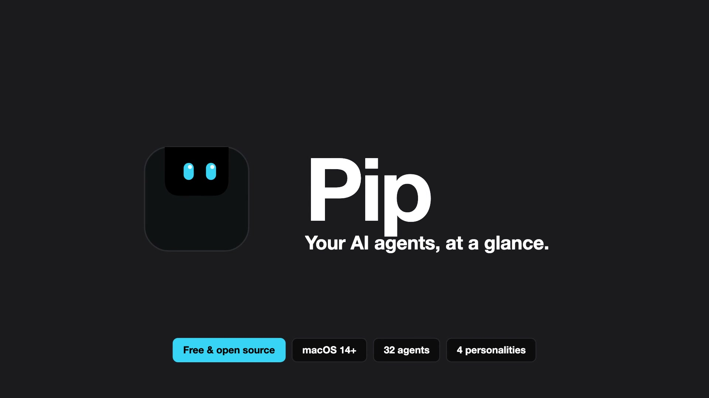
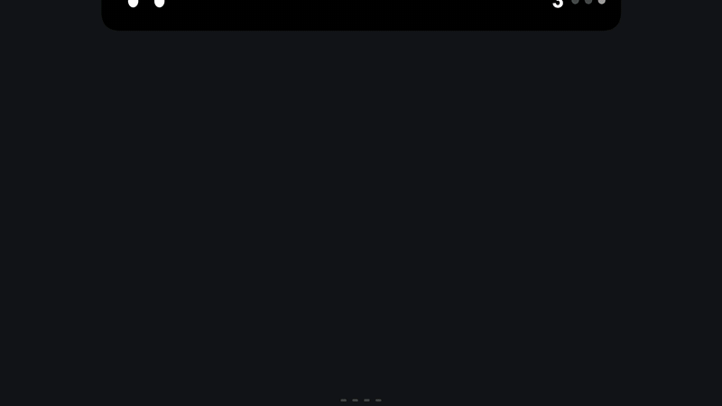
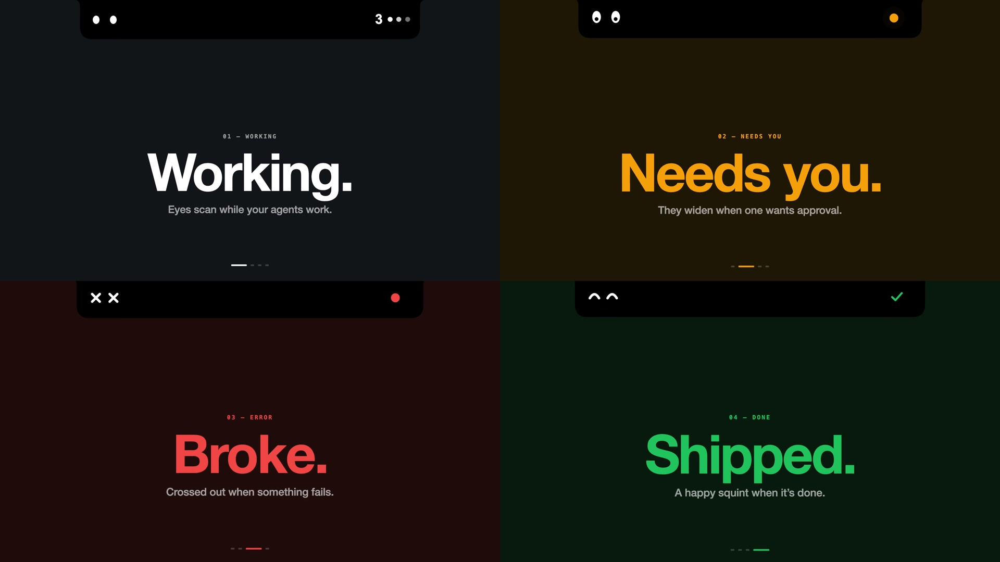
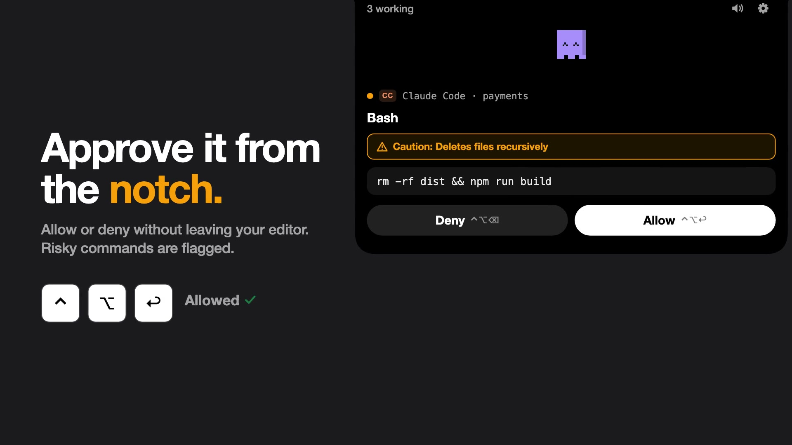
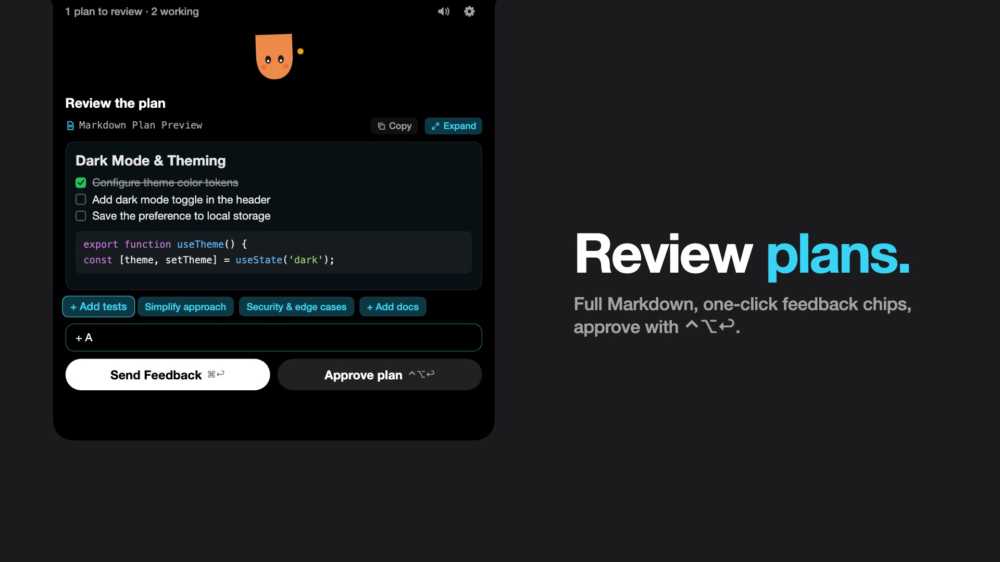
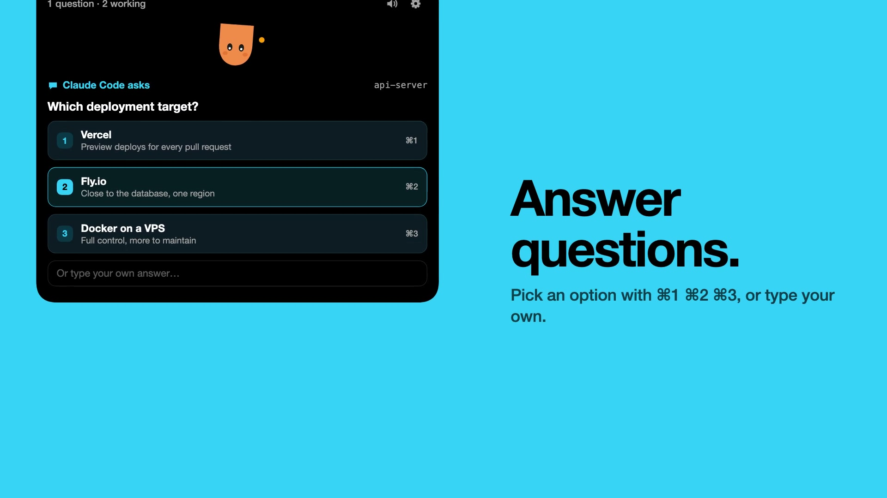
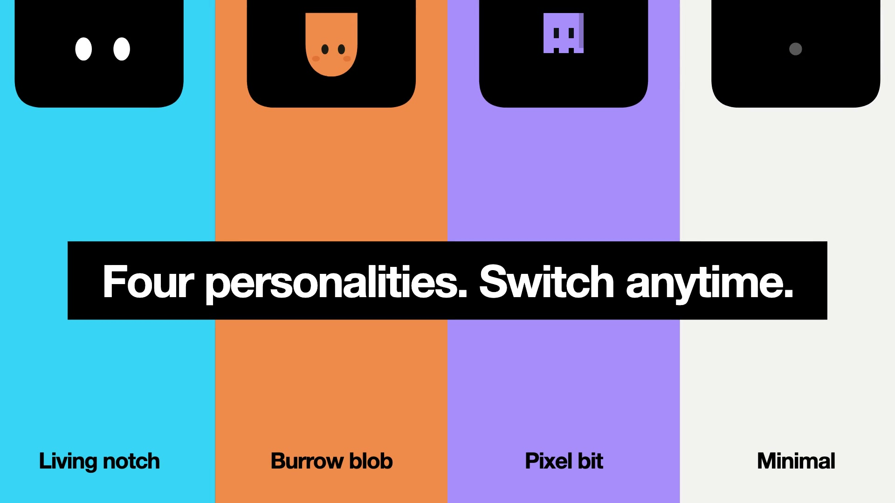
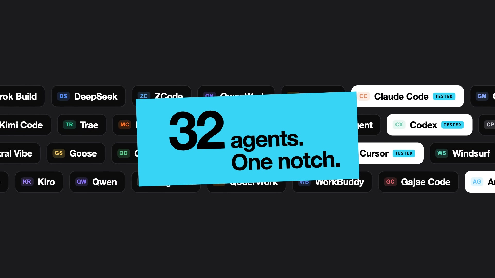
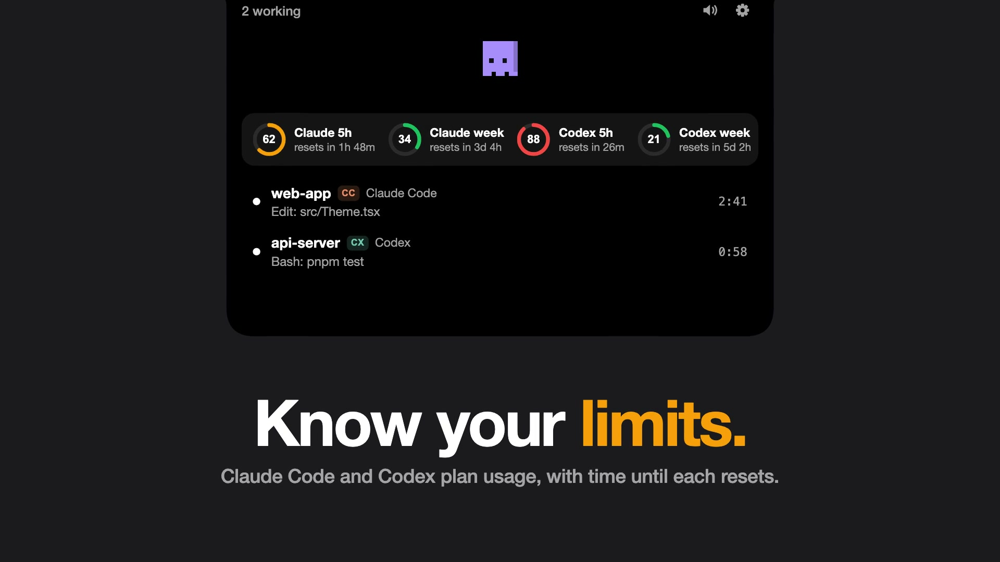

<p align="center">
  
</p>

<p align="center">
  <b>A macOS notch companion that shows what your AI coding agents are doing.</b><br>
  The notch itself has eyes: they scan while agents work, widen when one needs your approval,<br>
  cross out on errors and squint happily when a task finishes.
</p>

<p align="center">
  <a href="https://github.com/Kikatsu/pip-notch/actions/workflows/ci.yml"></a>
  
  
  
  <a href="LICENSE"></a>
</p>

<p align="center">
  
</p>

Pip supports 32 AI coding agents and their extensions inside VS Code, Cursor and other editors. **Claude Code, Codex, Antigravity CLI, Cursor, Copilot CLI, OpenCode and Pi are tested.** The rest are **experimental**: they're built from each agent's hook format but haven't been checked against a real install yet. If one doesn't work for you, please [open an issue](https://github.com/Kikatsu/pip-notch/issues/new/choose).

> [!NOTE]
> **Beta (0.1.0).** Pip isn't signed with an Apple Developer ID yet, so the recommended way to run it is to [build it from source](#install). If you download a prebuilt `Pip.app`, see [Running a downloaded build](#running-a-downloaded-build).

## Contents

- [Features](#features)
- [Install](#install)
- [First run](#first-run)
- [Connecting agents](#connecting-agents)
- [Usage limits](#usage-limits)
- [Characters and sounds](#characters-and-sounds)
- [Reviewing plans and questions](#reviewing-plans-and-questions)
- [Keyboard shortcuts](#keyboard-shortcuts)
- [Jumping to a session](#jumping-to-a-session)
- [Troubleshooting](#troubleshooting)
- [Uninstall](#uninstall)
- [How it fits together](#how-it-fits-together)
- [Contributing](#contributing)

## Features

| | |
| --- | --- |
|  | **Status at a glance.** Working, needs you, error and done each have their own eyes and colour, so you can tell what's going on without opening anything. |
|  | **Approve it from the notch.** Allow or deny tool requests without leaving your editor. Risky commands such as `rm -rf` are flagged. |
|  | **Review plans.** Full Markdown rendering, one-click feedback chips, and **Approve plan** with `⌃⌥↩`. |
|  | **Answer questions.** Pick an option with `⌘1` `⌘2` `⌘3`, or type your own answer. |
|  | **Four personalities.** Living notch, Burrow blob, Pixel bit or Minimal. You can switch at any time. |
|  | **32 agents, one notch.** Claude Code, Codex, Cursor, Gemini CLI, Copilot CLI, OpenCode, Windsurf and many more. |
|  | **Know your limits.** Claude Code and Codex plan usage, with the time until each limit resets. |

## Install

### Requirements

- A Mac running **macOS 14 Sonoma or later**. A notch isn't required; on Macs and displays without one, Pip draws its own at the top of the screen.
- **Xcode 16 or later** (from the App Store or [developer.apple.com](https://developer.apple.com/xcode/)). Open it once after installing so it can finish setting up.
- **[XcodeGen](https://github.com/yonaskolb/XcodeGen)**, which generates the Xcode project from `project.yml`.
- [Homebrew](https://brew.sh) is the easiest way to install XcodeGen.

### Build from source

**1. Install the tools**

```sh
xcode-select --install        # command line tools, if you don't have them yet
brew install xcodegen
```

**2. Get the code**

```sh
git clone https://github.com/Kikatsu/pip-notch.git
cd pip-notch
```

**3. Generate the Xcode project and build**

```sh
xcodegen generate
xcodebuild -project Pip.xcodeproj -scheme Pip -configuration Release \
  -derivedDataPath build/DerivedData build
```

**4. Move it to Applications and open it**

```sh
cp -R build/DerivedData/Build/Products/Release/Pip.app /Applications/
open /Applications/Pip.app
```

Pip lives in the notch and the menu bar (the little eyes icon). It has no Dock icon.

> [!TIP]
> Prefer Xcode? Run `xcodegen generate`, then `open Pip.xcodeproj` and press **⌘R**.

### Running a downloaded build

Prebuilt builds are ad-hoc signed rather than notarized, so macOS will say `Pip.app` "is damaged" or "can't be opened". Move it to `/Applications`, then clear the download flag once:

```sh
xattr -dr com.apple.quarantine /Applications/Pip.app
```

### Updating

```sh
cd pip-notch
git pull
xcodegen generate
xcodebuild -project Pip.xcodeproj -scheme Pip -configuration Release -derivedDataPath build/DerivedData build
osascript -e 'quit app "Pip"'
rm -rf /Applications/Pip.app && cp -R build/DerivedData/Build/Products/Release/Pip.app /Applications/
open /Applications/Pip.app
```

## First run

1. **Open Pip.** It finds the agents installed on your Mac and connects them automatically (see [Connecting agents](#connecting-agents)).
2. **Restart your agents.** Sessions that were already running before Pip connected won't have its hooks yet.
3. **Codex only:** click **Trust in Codex** in Settings → Agents (or run `/hooks` in Codex and trust Pip's hooks).
4. **Try it without an agent:** choose **Preview All States** from the menu bar eyes. This plays fake sessions from every agent through every state.
5. **Allow notifications** if macOS asks. The first time you jump into iTerm2 or Terminal, macOS also asks for Automation permission so Pip can bring the right tab forward.
6. **Optional:** open **Settings…** (from the menu bar eyes or the ⚙ in the notch) and turn on **Open at login** under General.

Launch flags for development:

```sh
open Pip.app --args --demo        # play the demo sessions on launch
open Pip.app --args --settings    # open Settings on launch
```

## Connecting agents

Pip connects every agent it finds automatically, at launch and every minute after, so agents you install later are picked up too. It also repairs hooks that an agent update removed. Pressing **Disconnect** in Settings keeps that agent off, and **Connect agents automatically** turns the whole behaviour off. Open **Settings…** (General, Agents, Appearance, Sounds, Shortcuts) from the eyes icon in the menu bar or the ⚙ in the notch.

When connecting, Pip copies its `pip-bridge` helper to `~/Library/Application Support/Pip/bin/` and adds its hooks to that agent's config, saving your last version without Pip's hooks as `<file>.pip-backup` (later reconnects and repairs never overwrite it). **Disconnect** removes only Pip's hooks.

<details>
<summary><b>All 32 supported agents</b> (click to expand)</summary>

| Agent | Status | Config file | What Pip shows |
| --- | --- | --- | --- |
| Claude Code | Tested | `~/.claude/settings.json` | Status, tools, approvals from the notch |
| Codex | Tested | `~/.codex/hooks.json` | Status, tools, approvals from the notch. Click **Trust in Codex** in Settings once. |
| ZCode (Z.ai, GLM) | Experimental | `~/.zcode/cli/config.json` | Status, tools, approvals from the notch. Pip turns on `hooks.enabled`, which ZCode needs to run any hook. |
| Gemini CLI | Experimental | `~/.gemini/settings.json` | Status, tools, replies; "needs you" when a tool prompt is waiting. Needs a Gemini API key: Google no longer lets free personal accounts sign in to Gemini CLI (it points them to Antigravity). |
| Antigravity CLI | Tested | `~/.gemini/config/hooks.json` | Status and tools for the app and `agy` CLI |
| Cursor | Tested | `~/.cursor/hooks.json` | Status, tools and replies for the app, `cursor-agent` and Grok Bot |
| Trae | Experimental | `~/.trae/hooks.json` | Status, commands, edits and replies from Trae IDE |
| OpenCode | Tested | `~/.config/opencode/plugins/pip.js` | Status, tools; "needs you" on permission prompts |
| MiMoCode | Experimental | `~/.mimocode/settings.json` | Status, tools, approvals from the notch |
| Droid | Experimental | `~/.factory/hooks.json`, else `~/.factory/settings.json` | Status, tools; "needs you" on permission prompts |
| Devin | Experimental | `~/.devin/hooks.json` | Status, tools, approvals from the notch |
| Qoder | Experimental | `~/.qoder/settings.json` | Status, tools, approvals from the notch |
| QoderWork | Experimental | `~/.qoderwork/settings.json` | Multi-agent status, tools, approvals from the notch |
| Qwen | Experimental | `~/.qwen/settings.json` | Status, tools, replies; "needs you" on permission prompts |
| QwenWork | Experimental | `~/.qwenwork/settings.json` | Workspace status, tools, replies |
| Grok Build | Experimental | `~/.grok/hooks/pip.json` | Status and replies for xAI's Grok Build |
| Kimi Code | Experimental | `~/.kimi-code/config.toml` | Status, tools, replies. Shows up only once you're logged in: Kimi starts no session until a model is set. |
| DeepSeek | Experimental | `~/.deepseek/settings.json` | Status, tools, replies |
| DeepSeek Harness (`dsh`) | Experimental | `~/.dsh/cordis.patch.yml` + `~/.dsh/pip-hooks.json` | Status, tools and replies. dsh's hook bridge has no approval event, so approvals stay in dsh |
| Mistral Vibe | Experimental | `~/.vibe/hooks.toml` | Status and replies for Mistral Vibe |
| Copilot CLI | Tested | `~/.copilot/hooks/pip.json` | Status, tools; "needs you" on permission prompts |
| CodeBuddy | Experimental | `~/.codebuddy/settings.json` | Companion status, tools, replies |
| WorkBuddy | Experimental | `~/.workbuddy/settings.json` | Assistant status, tools, replies |
| Kiro CLI | Not working yet | `~/.kiro/hooks/pip.json` | Kiro CLI 2.29 (the current release) only reads hooks from agent configs in `~/.kiro/agents/`, so these hooks don't load yet |
| Hermes | Experimental | `~/.hermes/hooks.json` | Agent status, tools, replies |
| Amp | Experimental | `~/.config/amp/settings.json` | Agent status, tools, replies |
| Pi Agent | Tested | `~/.pi/agent/extensions/pip.ts` | Status, tools, replies |
| Oh My Pi | Experimental | `~/.ohmypi/extensions/pip.ts` | Companion status, tools, replies |
| Gajae Code | Experimental | `~/.gajaecode/settings.json` | Agent status, tools, replies |
| Augment | Experimental | `~/.augment/settings.json` | Status, tools and replies for `auggie` |
| Goose | Experimental | `~/.agents/plugins/pip/` | Status, tools and replies |
| Windsurf | Experimental | `~/.codeium/windsurf/hooks.json` | Status, commands, edits and replies from Cascade |

</details>

Not supported yet: Zed's own agent has no hooks, and Zed doesn't run Claude Code hooks for its Claude integration (Codex and Gemini in Zed work through their own hooks). Cline's hook format couldn't be confirmed.

The Claude Code and Codex editor extensions use the same hooks as their CLIs. Each session row shows where it runs ("Claude Code · VS Code", "Codex · Ghostty"), and clicking it opens that project's editor window.

Only Claude Code's and Codex's `PermissionRequest` hooks wait for you, because only they fire exactly when the agent would otherwise ask you. Everything else runs in the background. **If Pip isn't running, the bridge exits at once with the agent's neutral answer, so agents behave as if no hook were installed.**

### Any other agent

Any agent with Claude-style hooks works too. Point its hooks at:

```sh
"~/Library/Application Support/Pip/bin/pip-bridge" my-agent
```

Settings → Agents → Other Agents has a Copy button for this. The agent shows up in the notch as "My-agent". Pip also accepts common field spellings such as `sessionId`, `working_dir` and `toolName`.

## Usage limits

The notch shows plan limits as rings (green, then amber from 60%, red from 85%) with the time until each resets:

- **Claude Code**: the 5-hour and weekly limits (and a spend limit behind a gateway). Claude Code only shares these with its status line, so Pip installs `pip-bridge claude-statusline` as the status line. If you already had one, Pip runs it unchanged and restores it when you turn this off; otherwise Claude Code shows a compact line such as `Opus 5.5 · 34% context · 5h 62% · week 88%`.
- **Codex**: the 5-hour and weekly limits, read from its local session logs in `~/.codex/sessions`.

Other agents don't expose their limits locally. Settings → General → Usage Limits chooses when to show them (always, only at 80% or higher, or never), can add the fullest limit as a small ring to the closed notch, and turns the Claude status line on or off.

## Characters and sounds

The character is interactive: its eyes follow your pointer as you approach the notch, it perks up (or wakes up) when the notch opens, giggles when you click its face, looks pleased when you allow a request and squints when you deny one.

Settings has three characters, **Living notch** (the notch has eyes), **Burrow blob** and **Pixel bit**, plus **Minimal**: no character, just a small status dot (white while working, pulsing amber when an agent needs you, red on errors, green when done) and a face-free panel.

Sounds come in four packs: **Pip** (bells and marimba), **Soft** (quiet glass and wood) and **Arcade** (8-bit blips) are synthesized by Pip itself, and **macOS** uses the alert sounds that ship with the system (Ping, Glass, Basso, Submarine). Any alert can use your own file instead (MP3, WAV, AIFF or M4A, up to 15 seconds); Pip keeps a copy in `~/Library/Application Support/Pip/Sounds`. Each alert can be switched off, and there's a master switch and a volume slider.

## Reviewing plans and questions

When an agent finishes planning, the plan appears in the notch with full Markdown rendering (headings, code blocks with copy buttons, checklists, tables, blockquotes). You can expand the preview for full reading, click quick feedback chips (`+ Add tests`, `⚡ Simplify`, etc.), and type feedback to send changes directly back without leaving the notch. **Approve plan** (`⌃⌥↩`) starts execution.

When an agent asks a question (Claude Code, Codex, Antigravity, and others), the notch presents the question and options as interactive cards with `⌘1`, `⌘2`, `⌘3` shortcuts, plus a field to type a custom answer without switching away. **Answer in terminal** remains available to jump to the session.

## Keyboard shortcuts

These work from any app (Settings → Shortcuts can turn them off):

| Keys | Action |
| --- | --- |
| `⌃⌥Space` | Open or close the notch |
| `⌃⌥↩` | Allow the request, or approve the plan |
| `⌃⌥⌫` | Deny the request, or keep planning |
| `⌃⌥J` | Go to the session that needs you most |
| `⌃⌥M` | Mute or unmute sounds |

`⌃⌥↩` and `⌃⌥⌫` are only claimed while a request is waiting.

## Jumping to a session

Clicking a session focuses where it runs:

- iTerm2: the exact session (AppleScript)
- Terminal.app: the exact tab, by tty
- tmux: the pane, then its terminal
- WezTerm: the pane
- Cursor, VS Code, Antigravity: the window with the project open
- Anything else: the app

The first jump into iTerm2 or Terminal asks for Automation permission.

## Troubleshooting

<details>
<summary><b>An agent doesn't show up in the notch</b></summary>

1. Open **Settings → Agents** and check that the agent says **Connected**. If not, press **Connect**.
2. Restart the agent. Sessions started before Pip connected don't have its hooks.
3. For Codex, run `/hooks` and trust Pip's hooks.
4. Check that the bridge exists: `ls ~/Library/Application\ Support/Pip/bin/pip-bridge`.
5. Look at Pip's logs: `log stream --predicate 'subsystem BEGINSWITH "com.kikatsu.pip"' --level debug`.

If it still doesn't work and the agent is marked *Experimental*, please [report it](https://github.com/Kikatsu/pip-notch/issues/new?template=agent_report.yml). Include the agent's version and its hook config with any secrets removed.
</details>

<details>
<summary><b>Codex is connected but never shows up</b></summary>

Codex only runs hooks you've reviewed, and it skips untrusted ones without any error. Pip warns about this in Settings → Agents, in the menu bar menu and with a notification.

- **One click:** Settings → Agents → **Trust in Codex**. Pip asks Codex to trust only the hooks that run Pip's bridge, the same request `/hooks` makes. Your other hooks are left as they are.
- **Or by hand:** start `codex`, type `/hooks` and trust the entries that run `…/Pip/bin/pip-bridge codex`.

Then start a new Codex session.

After a Codex update, check `/hooks` again: if your `~/.codex/config.toml` was reset, the trust goes with it.
</details>

<details>
<summary><b>"Pip.app is damaged and can't be opened"</b></summary>

This is Gatekeeper blocking an unnotarized download. Run `xattr -dr com.apple.quarantine /Applications/Pip.app`, or build from source.
</details>

<details>
<summary><b>Clicking a session doesn't focus my terminal</b></summary>

Allow Pip under **System Settings → Privacy & Security → Automation** (for iTerm2 / Terminal). If you said no the first time, reset it with `tccutil reset AppleEvents com.kikatsu.pip` and try again.
</details>

<details>
<summary><b>Global shortcuts don't work</b></summary>

Check that they're on in **Settings → Shortcuts** and that no other app has taken the same keys.
</details>

<details>
<summary><b>My agent waits for a while when Pip is closed</b></summary>

It shouldn't: the bridge exits immediately with a neutral answer when Pip isn't running. If you see a delay, please open an issue with the agent name and version.
</details>

## Uninstall

1. Open **Settings → Agents** and **Disconnect** each connected agent. This removes only Pip's hooks and restores your previous Claude Code status line.
2. Quit Pip from the menu bar eyes (**Quit Pip**).
3. Delete the app and its data:

```sh
rm -rf /Applications/Pip.app
rm -rf ~/Library/Application\ Support/Pip
defaults delete com.kikatsu.pip 2>/dev/null
```

Your original agent configs are still saved next to each one as `<file>.pip-backup` if you ever need them.

## How it fits together

```
agent hook ──▶ pip-bridge (stdin JSON) ──▶ Unix socket ──▶ Pip.app
                                  ◀── allow / deny ──
```

```
.
├── project.yml              XcodeGen spec (the .xcodeproj is generated, not committed)
├── Sources/
│   ├── App/
│   │   ├── Core/            session state (SessionStore), per-agent adapters, socket server,
│   │   │                    hook installers, sounds, usage limits, terminal jumping
│   │   ├── Notch/           the panel, notch geometry, hover tracking
│   │   ├── Settings/        the Settings window
│   │   └── Views/           the notch shape, the characters and the panel content
│   ├── Bridge/              pip-bridge: the small helper that agent hooks call
│   └── Shared/              code used by both the app and the bridge (paths, socket I/O)
├── Tests/PipTests/          unit tests
├── docs/images/             README screenshots
└── video/                   Remotion source for the promo video (optional)
```

Pip talks to agents only through their local hook files and a Unix socket in `~/Library/Application Support/Pip/`. It makes no network requests and collects no telemetry.

## Contributing

Contributions are welcome, especially reports from people who use the **experimental** agents. See [CONTRIBUTING.md](CONTRIBUTING.md) for how to build, test and add support for a new agent.

Run the tests with:

```sh
xcodegen generate
xcodebuild -project Pip.xcodeproj -scheme Pip -derivedDataPath build/DerivedData test
```

Please read the [Code of Conduct](CODE_OF_CONDUCT.md). To report a security issue, see [SECURITY.md](SECURITY.md).

## License

MIT. See [LICENSE](LICENSE).
